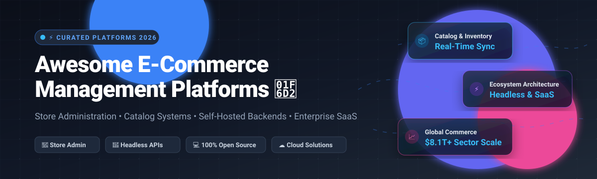

# 🛒 Awesome E-Commerce Management Platform [](https://awesome.re)

<p align="center">
  
</p>

<p align="center">
  <strong>⚡ Curated directory of enterprise SaaS solutions, store administration dashboards, headless commerce engines, and self-hosted open-source platforms. 🚀</strong>
</p>

<p align="center">
  <a href="https://github.com/ishandutta2007/Awesome-Awesome-Awesome"></a>
  <a href="https://discord.gg/jc4xtF58Ve"></a>
  <a href="https://github.com/ishandutta2007/Awesome-E-Commerce-Management-Platform/stargazers"></a>
  <a href="https://github.com/ishandutta2007/Awesome-E-Commerce-Management-Platform/network/members"></a>
  <a href="https://github.com/ishandutta2007/Awesome-E-Commerce-Management-Platform/blob/main/LICENSE"></a>
  <a href="https://github.com/ishandutta2007/Awesome-Awesome-Awesome"></a>
  <a href="https://github.com/ishandutta2007"></a>
</p>

---

## 📖 Introduction & Scope

💡 **E-commerce Management Platforms** provide the core operational nervous system for online retail businesses. They orchestrate product catalogs, multi-channel inventory, customer data records (CRM), order processing workflows, pricing strategies, and checkout gateways through administrative control panels or headless API microservices.

Whether you are scaling a fast-moving direct-to-consumer (D2C) brand, building a high-volume multi-vendor marketplace, orchestrating enterprise B2B wholesale portals, or maintaining self-hosted data-sovereign commerce backends, this guide tracks market-leading commercial SaaS suites and battle-tested open-source GitHub alternatives.

---

## 📑 Table of Contents

- [📊 Sector Overview & Market Dynamics](#-sector-overview--market-dynamics)
- [☁️ SaaS & Hosted Platforms](#️-saas--hosted-platforms)
- [💻 Open-Source GitHub Projects](#-open-source-github-projects)
  - [⭐ Top Open-Source Commerce Platforms Ranked by Stars](#-top-open-source-commerce-platforms-ranked-by-stars)
  - [🐘 PHP & Laravel Frameworks](#-php--laravel-frameworks)
  - [🟢 Node.js, TypeScript & Headless Backends](#-nodejs-typescript--headless-backends)
  - [💎 Ruby on Rails Solutions](#-ruby-on-rails-solutions)
  - [🔷 .NET & Enterprise Engines](#-net--enterprise-engines)
- [🏛️ Architectural Comparison: SaaS vs Open Source](#️-architectural-comparison-saas-vs-open-source)
- [🧭 Decision Matrix & Platform Selection Guide](#-decision-matrix--platform-selection-guide)
- [⭐ Star History](#-star-history)
- [💖 Support](#-support)
- [🤝 How to Contribute](#-how-to-contribute)
- [📜 Disclaimer](#-disclaimer)
- [📄 License](#-license)

---

## 📊 Sector Overview & Market Dynamics

📈 The global e-commerce platform and management software market was valued at **$8.15 billion in 2025** and is projected to expand to **$21.6 billion by 2033**, growing at a compound annual growth rate (CAGR) of **13.0%**.

Market dynamics reflect a **moderately fragmented yet polarizing barbell structure**:
- 🏢 **Concentrated Enterprise SaaS Tier**: At the hyper-scale and enterprise end, giant SaaS ecosystems like SAP Commerce Cloud, Salesforce Commerce Cloud, Adobe Commerce, and Shopify dominate gross merchandise volume (GMV) with winner-take-most marketplace effects, unified checkout rails, and extensive enterprise integration moats.
- 🌐 **Fragmented Composable & Headless Mid-Market**: Concurrently, the mid-market and SMB landscape remains dynamic and fragmented. High demand for custom frontends, headless MACH architectures (Microservices, API-first, Cloud-native, Headless), and local data compliance has fueled massive adoption of modular solutions (Commerce Layer, BigCommerce) alongside thriving open-source frameworks (Medusa, Bagisto, Saleor, WooCommerce).

---

## ☁️ SaaS & Hosted Platforms

The table below catalogs premier hosted e-commerce management platforms, sorted descending by company scale (valuation or enterprise market capitalization / annual recurring revenue).

| Platform | Pricing (Starting Tier) | Free Tier Limit / Trial Period | Scale (Valuation / Revenue) | Core Capabilities & Highlights |
| :--- | :--- | :--- | :--- | :--- |
| **[SAP Commerce Cloud](https://www.sap.com/products/crm/e-commerce-platforms.html)** | **$4,167/month** ($50,000/year base implementation tier) | **30-day guided evaluation sandbox** (pre-configured enterprise scenario environment) | **~$280 Billion Market Cap** (Public: ETR: SAP; ~$34B Annual Revenue) | Comprehensive enterprise commerce engine designed for deep SAP S/4HANA ERP integration, complex B2B matrix catalogs, multi-currency price books, and quote negotiation. |
| **[Salesforce Commerce Cloud](https://www.salesforce.com/products/commerce/)** | **$1,250/month** (Starter Suite) + 1% to 2% GMV transaction fee | **30-day fully functional trial** (up to 5 store administrators and sample product data) | **~$265 Billion Market Cap** (Public: NYSE: CRM; ~$38B Annual Revenue) | Scalable multi-cloud commerce suite native to Salesforce CRM; offers automated AI merchandising via Agentforce/Einstein, localized checkout, and unified omnichannel routing. |
| **[Adobe Commerce](https://business.adobe.com/products/magento/magento-commerce.html)** | **$1,833/month** ($22,000/year base gross merchandise value tier) | **30-day sandbox trial** (developer demo environment with sample catalog data) | **~$210 Billion Market Cap** (Public: NASDAQ: ADBE; ~$21B Annual Revenue) | Enterprise iteration of Magento featuring native multi-brand/multi-store administration, advanced Elasticsearch/Live Search indexing, and B2B requisition lists. |
| **[Shopify Admin](https://www.shopify.com/)** | **$39/month** (Basic plan, billed annually) or $29/mo promo | **3-day free trial**, followed by promotional **$1/month for the first 3 months** | **~$108 Billion Market Cap** (Public: NYSE: SHOP; ~$8.8B ARR) | The industry standard for hosted store operations; features Shop Pay 1-click checkout, centralized multi-channel inventory sync, POS sync, and 8,000+ app marketplace integrations. |
| **[Wix eCommerce](https://www.wix.com/ecommerce)** | **$29/month** (Core eCommerce tier) | **14-day full money-back guarantee trial period** with full dashboard access | **~$11 Billion Market Cap** (Public: NASDAQ: WIX; ~$1.7B Annual Revenue) | Visual site builder combined with integrated inventory, order tracking, automated sales tax via Avalara, and multi-channel marketplace listing tools. |
| **[Squarespace](https://www.squarespace.com/ecommerce-website)** | **$28/month** (Business tier, billed annually) | **14-day free trial** (unlimited access to admin dashboard and store builder) | **~$6.9 Billion Valuation** (Acquired / Private; ~$1.1B Annual Revenue) | Design-first store management platform tailored for boutique brands, digital creators, and portfolio merchandising with integrated shipping labels and gift card workflows. |
| **[BigCommerce](https://www.bigcommerce.com/)** | **$29/month** (Standard plan, billed annually) | **15-day full-feature free trial** with complete product catalog management | **~$480 Million Market Cap** (Public: NASDAQ: BIGC; ~$330M Annual Revenue) | Feature-rich API-first SaaS platform with zero additional transaction fees, native wholesale customer group pricing, multi-storefront routing, and ERP connector support. |
| **[Commerce Layer](https://commercelayer.io/)** | **$649/month** (Growth plan with SLA) | **Forever-free Developer Plan** (up to 100 orders/month, 1 market, unlimited API requests) | **~$120 Million Valuation** (Series B funded; ~$15M ARR estimate) | MACH-certified headless commerce engine offering global shopping APIs, multi-currency price sheets, inventory split-fulfillment, and localized tax/payment orchestration. |
| **[PrestaShop Hosted](https://www.prestashop.com/)** | **€24/month** (~$26/month, PrestaShop Hosted edition) | **14-day full access free trial** with demo catalog and back-office management | **~$80 Million Valuation** (Acquired by MBE Worldwide; ~$40M Annual Revenue) | Cloud-hosted version of the open-source European favorite; includes pre-configured hosting, automated SSL, essential module bundles, and payment gateway presets. |
| **[WooCommerce Managed](https://woocommerce.com/)** | **$25/month** (Base managed WooCommerce hosting tier) | **14-day free trial period** (via managed WordPress hosting partners) | **Part of Automattic (~$7.5B Valuation)** | Managed hosted variant of the open-source WordPress commerce plugin, providing automated core/extension updates, staging environments, and priority server caching. |

---

## 💻 Open-Source GitHub Projects

Open-source commerce management software provides total data sovereignty, unmetered customization freedom, and zero platform transaction cuts. Below is a curated collection of production-ready engines, ranked by community adoption.

### ⭐ Top Open-Source Commerce Platforms Ranked by Stars

The table below catalogs premier open-source e-commerce backends, sorted descending by GitHub community Stars_Count.

| Repository | GitHub_Stars_Badge | Primary Language / Stack | Architecture & Core Capabilities |
| :--- | :--- | :--- | :--- |
| **[Medusa](https://github.com/medusajs/medusa)** | [](https://github.com/medusajs/medusa/stargazers) | TypeScript / Node.js / PostgreSQL | Composable commerce engine dubbed "the open-source Shopify alternative." Built modularly with a modern React admin panel, event-driven workflows, multi-region pricing, and extensible plugins. |
| **[Bagisto](https://github.com/bagisto/bagisto)** | [](https://github.com/bagisto/bagisto/stargazers) | PHP / Laravel / Vue.js | Enterprise-grade Laravel e-commerce platform offering native multi-vendor marketplace capabilities, AI product descriptions, localized RTL support, and dedicated mobile app APIs. |
| **[Saleor](https://github.com/saleor/saleor)** | [](https://github.com/saleor/saleor/stargazers) | Python / Django / GraphQL | Ultra-fast headless commerce engine utilizing GraphQL API endpoints, PostgreSQL, and modern React dashboard. Features multi-channel order routing, flexible pricing, and webhook hooks. |
| **[Spree Commerce](https://github.com/spree/spree)** | [](https://github.com/spree/spree/stargazers) | Ruby on Rails / Turbo / Stimulus | Battle-tested modular commerce platform powering over $2B in GMV. Features enterprise B2B multi-store administration, mobile responsive storefronts, and REST/GraphQL APIs. |
| **[Magento Open Source](https://github.com/magento/magento2)** | [](https://github.com/magento/magento2/stargazers) | PHP / MySQL / Elasticsearch | The heavyweight open-source enterprise commerce engine (Adobe Commerce CE). Unrivaled catalog depth, complex configurable attributes, multi-site hierarchy, and 5,000+ community extensions. |
| **[WooCommerce](https://github.com/woocommerce/woocommerce)** | [](https://github.com/woocommerce/woocommerce/stargazers) | PHP / WordPress / React | The most widely deployed open-source commerce tool on the web. Empowers millions of merchants with zero licensing cost, unlimited product catalogs, and 60,000+ WordPress integrations. |
| **[EverShop](https://github.com/evershopcommerce/evershop)** | [](https://github.com/evershopcommerce/evershop/stargazers) | JavaScript / Node.js / React | Modern full-stack Node.js commerce platform designed with clean modular architecture, customizable React storefront, fast PostgreSQL persistence, and built-in order management. |
| **[nopCommerce](https://github.com/nopSolutions/nopCommerce)** | [](https://github.com/nopSolutions/nopCommerce/stargazers) | C# / .NET Core / MS SQL | Premier Microsoft .NET open-source commerce platform. Backed by a comprehensive administrative dashboard, native multi-tenant multi-store capabilities, and 1,500+ marketplace integrations. |
| **[PrestaShop](https://github.com/PrestaShop/PrestaShop)** | [](https://github.com/PrestaShop/PrestaShop/stargazers) | PHP / Symfony / MySQL | Leading European open-source commerce solution balancing enterprise capabilities with modular simplicity. Features a massive multilingual international module ecosystem. |
| **[Sylius](https://github.com/Sylius/Sylius)** | [](https://github.com/Sylius/Sylius/stargazers) | PHP / Symfony | Architecturally pristine commerce framework built with Domain-Driven Design (DDD) and 100% test coverage. Ideal for custom B2B, B2C, and multi-tier subscription applications. |
| **[Vendure](https://github.com/vendurehq/vendure)** | [](https://github.com/vendurehq/vendure/stargazers) | TypeScript / NestJS / GraphQL | Developer-friendly headless commerce backend featuring built-in TypeScript decorators, flexible channel-based multi-tenancy, and blazing-fast administrative user experience. |
| **[OpenCart](https://github.com/opencart/opencart)** | [](https://github.com/opencart/opencart/stargazers) | PHP / MVC / MySQL | Lightweight, turnkey e-commerce solution running on shared PHP hosting. Features a low resource footprint, built-in multi-currency handling, and 13,000+ downloadable modules. |
| **[Aimeos](https://github.com/aimeos/aimeos)** | [](https://github.com/aimeos/aimeos/stargazers) | PHP / Laravel / Symfony | Ultra-high performance e-commerce framework capable of rendering complex catalogs with 1,000,000+ products in under 20ms response time; supports multi-vendor and multi-warehouse out of the box. |
| **[Solidus](https://github.com/solidusio/solidus)** | [](https://github.com/solidusio/solidus/stargazers) | Ruby on Rails / ViewComponent | Stability-focused open-source Rails fork of Spree. Managed by an independent community steering committee, prioritizing long-term backwards compatibility and enterprise reliability. |
| **[Shopware](https://github.com/shopware/shopware)** | [](https://github.com/shopware/shopware/stargazers) | PHP / Symfony / Vue.js | Enterprise European commerce engine powering leading brands. Features a visual CMS Rule Builder, Flow Builder for automated business logic, and native headless API endpoints. |

---

### 🐘 PHP & Laravel Frameworks

- **[WooCommerce](https://github.com/woocommerce/woocommerce)** — Powers roughly 30% of all top 1M online stores. Free core plugin for WordPress with zero platform revenue cut and boundless extension options.
- **[Bagisto](https://github.com/bagisto/bagisto)** — Fast-growing Laravel-powered open-source commerce with native multi-currency, multi-store, and marketplace modules.
- **[Magento Open Source](https://github.com/magento/magento2)** — Benchmark for complex enterprise catalogs requiring granular attributes, customer group pricing, and advanced caching.
- **[PrestaShop](https://github.com/PrestaShop/PrestaShop)** — Popular across European mid-market merchants; balances Magento's complexity with a structured module marketplace.
- **[Sylius](https://github.com/Sylius/Sylius)** — Built strictly on Symfony full-stack; perfect for development teams wanting clean architecture, unit testing, and custom business logic.
- **[Aimeos](https://github.com/aimeos/aimeos)** — Engineered for high scalability; integrates smoothly into existing Laravel installations to support ultra-fast sub-20ms rendering.
- **[OpenCart](https://github.com/opencart/opencart)** — Pragmatic, classic PHP MVC store system suitable for straightforward catalogs on standard web hosting.

### 🟢 Node.js, TypeScript & Headless Backends

- **[Medusa](https://github.com/medusajs/medusa)** — Highly customizable headless engine with modular architecture, intuitive admin UI, and out-of-the-box Stripe/SendGrid integrations.
- **[Vendure](https://github.com/vendurehq/vendure)** — NestJS and TypeScript-powered backend with a GraphQL-first approach, multi-channel support, and developer-first configuration.
- **[EverShop](https://github.com/evershopcommerce/evershop)** — Complete full-stack JavaScript commerce solution utilizing React on the frontend and Node.js on the backend.

### 💎 Ruby on Rails Solutions

- **[Spree Commerce](https://github.com/spree/spree)** — Veteran Ruby commerce platform with modern storefronts, REST API v2, responsive admin UI, and extensive community extensions.
- **[Solidus](https://github.com/solidusio/solidus)** — Forked from Spree to prioritize core architectural stability, enterprise compliance, and vendor-neutral maintenance.

### 🔷 .NET & Enterprise Engines

- **[nopCommerce](https://github.com/nopSolutions/nopCommerce)** — Industry standard in the ASP.NET ecosystem; feature-rich admin dashboard, multi-vendor support, and active enterprise community.
- **[Shopware](https://github.com/shopware/shopware)** — Modern German-engineered commerce platform built with Symfony and Vue.js, featuring visual drag-and-drop experience design.
- **[Saleor](https://github.com/saleor/saleor)** — Python/Django headless commerce engine delivering GraphQL APIs tailored for global composable storefronts.

---

## 🏛️ Architectural Comparison: SaaS vs Open Source

```
+-----------------------------------------------------------------------------------+
|                         COMMERCE PLATFORM ARCHITECTURE                            |
+-----------------------------------------------------------------------------------+
|                                                                                   |
|  [ Enterprise SaaS Suites ]                        [ Open-Source / Self-Hosted ]  |
|  * Shopify Admin, Salesforce, SAP                  * Medusa, Bagisto, Saleor      |
|  * BigCommerce, Adobe Commerce                     * WooCommerce, Sylius, Spree   |
|                                                                                   |
|   +--------------------------+                      +--------------------------+  |
|   | Fully Managed Infra      |                      | 100% Code & Data Control |  |
|   | Automatic PCI Compliance |                      | Zero Revenue Commission  |  |
|   | 99.99% Guaranteed SLA    |                      | Infinite DB Customization|  |
|   | Scaled Edge CDN          |                      | Deploy Anywhere (Docker) |  |
|   +--------------------------+                      +--------------------------+  |
|                |                                                 |                |
|                v                                                 v                |
|   [ Turnkey Storefront & UI ]                       [ Custom Frontends / APIs ]   |
|   Monthly Fees + Rev Share                          Self-Managed Ops & Hosting    |
|                                                                                   |
+-----------------------------------------------------------------------------------+
```

---

## 🧭 Decision Matrix & Platform Selection Guide

1. 🚀 **For fastest launch & zero maintenance burden**: Choose **Shopify Admin** or **BigCommerce**. You get world-class checkout speed and turnkey payment integration without managing servers.
2. 🏢 **For enterprise ERP alignment & heavy B2B transactions**: Choose **SAP Commerce Cloud**, **Salesforce Commerce Cloud**, or **Adobe Commerce**.
3. 🌐 **For composable, API-first headless architectures**: Select **Commerce Layer** (SaaS) or self-host **Medusa**, **Saleor**, or **Vendure** (Node/Python/TypeScript).
4. 🛠️ **For PHP/Laravel ecosystems & marketplaces**: Adopt **Bagisto** for rapid multi-vendor setups, or **Sylius** for clean Symfony domain-driven engineering.
5. 🧩 **For WordPress-integrated content sites**: Deploy **WooCommerce** with dedicated caching and managed hosting.
6. 🔒 **For high-scale Microsoft IT stacks**: Deploy **nopCommerce** on ASP.NET Core and Microsoft SQL Server.

---

## ⭐ Star History

[](https://star-history.dera.page/#ishandutta2007/Awesome-E-Commerce-Management-Platform&type=date&legend=top-left)

---

## 💖 Support

A massive **thank you** 🙏 to all developers, store administrators, merchants, and open-source contributors who build with and support this curated directory!

If you find this repository valuable, please consider supporting the project:
- ⭐ **Star** this repository on GitHub to boost visibility for the community.
- 🍴 **Fork** and share it with your engineering team, fellow developers, and retail founders.
- 📢 **Contribute**: Submit a PR to add or update emerging SaaS tools or open-source commerce projects.
- ☕ **Buy me a coffee**: Support ongoing curation, research, and maintenance via the [GitHub Sponsor Dashboard](https://github.com/sponsors/ishandutta2007).

---

## 🤝 How to Contribute

Contributions are welcome! Please follow these guidelines:

1. 🍴 Fork this repository.
2. 🔍 Ensure new SaaS additions include verifiable starting tier pricing and specific free trial terms.
3. ⭐ Ensure new open-source additions include active GitHub repositories and accurate Stars_Count badges.
4. 📝 Add your entry to the appropriate section and submit a Pull Request with a clear summary.

---

## 📜 Disclaimer

- This is a **community-curated** list — not exhaustive and not an endorsement.
- E-commerce platforms handling card payments and customer PII must comply with **PCI DSS** standards; self-hosted solutions require security hardening, SSL management, and data backups.
- Always verify licensing conditions prior to commercial deployment: WooCommerce is GPL, Bagisto is MIT, Medusa is MIT, Saleor is BSD-3-Clause, Magento Open Source is OSL/AFL, PrestaShop is OSL-3.0, and nopCommerce is GPL-3.0.

---

## 📄 License

This project is licensed under the [MIT License](LICENSE).
